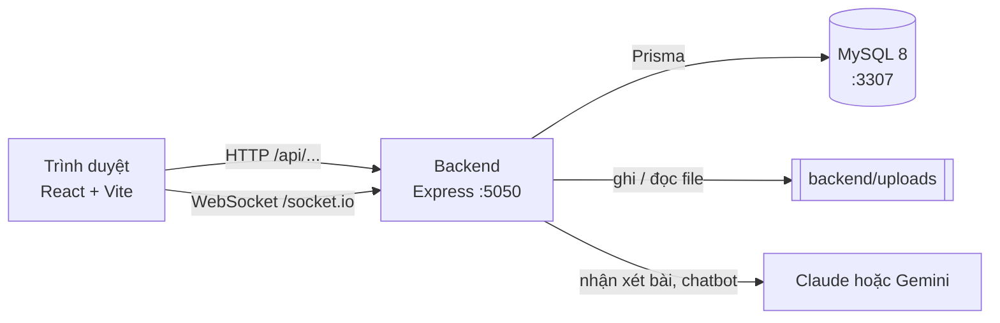
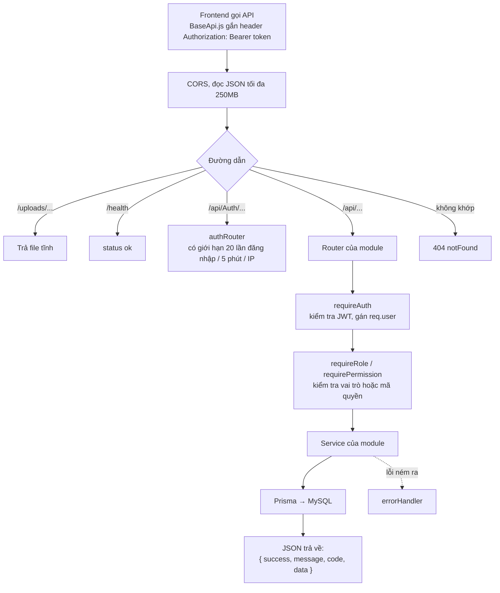
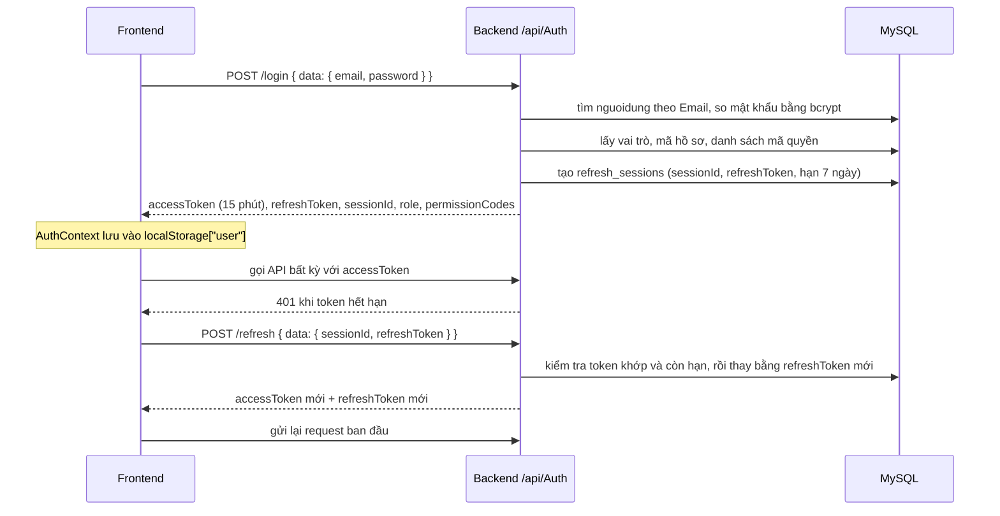
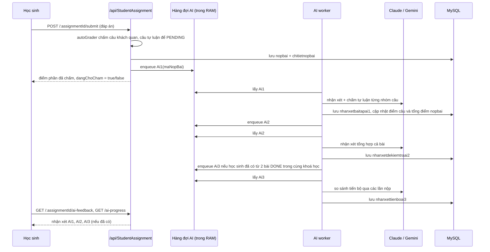
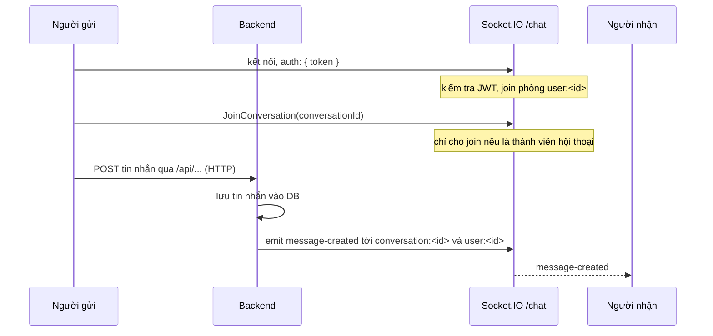
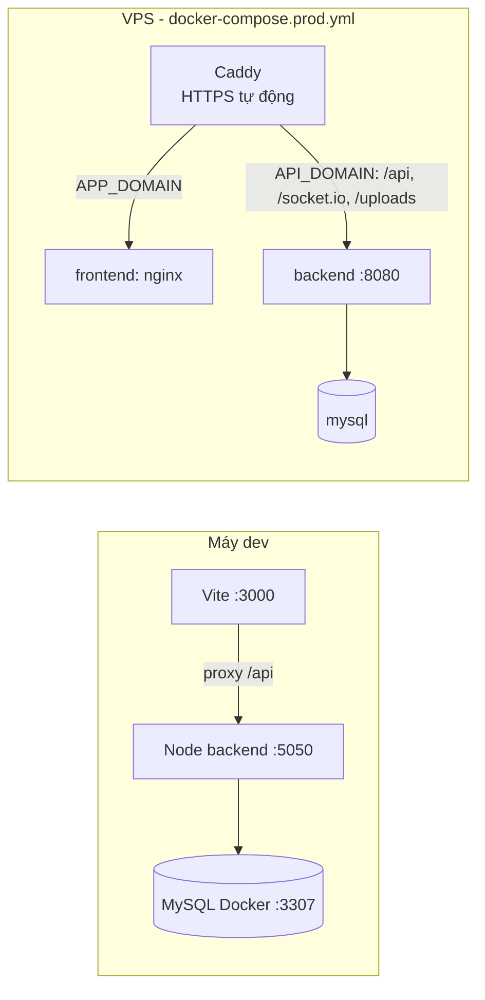

# Kiến trúc và luồng chạy

Tài liệu này mô tả hệ thống chạy như thế nào: các thành phần, một request đi qua đâu, và các luồng
nghiệp vụ chính. Cách cài đặt và chạy xem [README.md](README.md). Quy ước viết module backend xem
[backend/PORTING_GUIDE.md](backend/PORTING_GUIDE.md).

## 1. Tổng quan



| Thành phần | Vị trí | Cổng khi chạy dev |
|---|---|---|
| Frontend React | [frontend/src/](frontend/src/) | 3000 (`npm run dev`) |
| Backend API + Socket.IO | [backend/src/](backend/src/) | 5050 (`npm run dev`) |
| MySQL | container `mysql` trong [docker-compose.yml](docker-compose.yml) | 3307 |
| File upload | `backend/uploads/`, phục vụ qua đường dẫn `/uploads/...` | (đi chung backend) |

Khi chạy dev, Vite chuyển tiếp mọi request `/api/...` từ cổng 3000 sang backend 5050
([vite.config.js](frontend/vite.config.js)), nên frontend gọi API như cùng một domain.

## 2. Backend khởi động

[backend/src/server.ts](backend/src/server.ts) làm 3 việc:

1. `createApp()` dựng ứng dụng Express ([app.ts](backend/src/app.ts)).
2. `attachRealtime(server)` gắn Socket.IO lên cùng HTTP server ([realtime/socket.ts](backend/src/realtime/socket.ts)).
3. Sau khi mở cổng, gọi `startAiFeedbackWorker()` để chạy vòng xử lý hàng đợi AI (mục 6).

Cấu hình đọc từ biến môi trường trong [config.ts](backend/src/config.ts). Lưu ý: process luôn chạy với
`TZ=UTC`, nên giờ lưu trong DB chính là giờ hiển thị, không bị lệch 7 tiếng trên Windows.

## 3. Một request API đi qua những đâu



Những điểm cần biết:

- **Mỗi module là một thư mục** trong [backend/src/modules/](backend/src/modules/), gồm `*.routes.ts` (khai báo
  đường dẫn đầy đủ `/api/...`), `*.service.ts` (nghiệp vụ), đôi khi có `*.repository.ts` (truy vấn DB).
  Tất cả router được gắn trong [app.ts](backend/src/app.ts).
- **`req.user`** sau `requireAuth` có dạng `{ userId, email, role, fullName, profileId }`. `profileId` là mã
  học sinh, mã giảng viên hoặc mã phụ huynh, tuỳ vai trò ([middlewares/auth.ts](backend/src/middlewares/auth.ts)).
- **Dạng JSON giữ y như bản .NET cũ**: ngày giờ dạng `"2026-11-11T13:41:30"` (không có `Z`), số thập phân thành
  `number` ([utils/dotnetCompat.ts](backend/src/utils/dotnetCompat.ts)). Body request của một số API bọc trong
  `data`, ví dụ đăng nhập là `{ "data": { "email": "...", "password": "..." } }`.

## 4. Đăng nhập, token và phân quyền

### 4.1 Đăng nhập và làm mới token



- Mã nguồn: [auth.routes.ts](backend/src/modules/auth/auth.routes.ts), [auth.service.ts](backend/src/modules/auth/auth.service.ts).
- **Refresh token chỉ dùng được một lần.** Mỗi lần refresh, token cũ bị thay. Nếu ai gửi token cũ hoặc token
  đã hết hạn, backend xoá luôn phiên đó và người dùng phải đăng nhập lại.
- Tài khoản cũ còn lưu mật khẩu dạng chữ thường vẫn đăng nhập được; ngay lần đăng nhập đó mật khẩu được băm
  lại bằng bcrypt.
- Ở frontend, [BaseApi.js](frontend/src/api/BaseApi.js) tự gọi refresh khi gặp 401. Refresh thất bại thì xoá
  `localStorage["user"]` và đưa về trang đăng nhập.
- `POST /api/Auth/logout` xoá phiên refresh. `POST /api/Auth/refresh-permissions/:userId` lấy lại danh sách
  quyền mới sau khi admin đổi quyền.

### 4.2 Phân quyền

Quyền được cấu hình trong DB, theo chuỗi:

```
nguoidung ──< nguoidungvaitro >── vaitro ──< vaitroquyen >── quyen (TenQuyen, MaChucNang)
```

Có 4 vai trò chính: `Admin`, `Giao_Vien`, `Hoc_Sinh`, `Phu_Huynh`.

Quyền được kiểm tra ở **hai nơi**, và chỉ chặn ở backend mới thật sự an toàn:

| Nơi | Cách kiểm tra | Mục đích |
|---|---|---|
| Frontend [PrivateRoute.jsx](frontend/src/routes/PrivateRoute.jsx) | `requiredPermissions` so với `user.permissionCodes` nhận lúc đăng nhập | Ẩn trang, chuyển hướng người không có quyền |
| Backend [permission.ts](backend/src/middlewares/permission.ts) | `requirePermission('MA_QUYEN')` tra bảng `vaitroquyen` **mỗi request** | Chặn thật, trả 403 |

Vì backend tra DB mỗi lần, admin đổi quyền là có hiệu lực ngay ở API. Còn menu và trang ở frontend chỉ cập nhật
sau khi người dùng đăng nhập lại hoặc gọi `refresh-permissions`.

## 5. Frontend

```
frontend/src/
  main.jsx, App.jsx    Khai báo route: /login, /admin/*, /teacher/*, /student/*, /parent/*
  context/             AuthContext (người dùng đang đăng nhập), StudentClassContext, TestContext
  routes/              PrivateRoute (chặn theo đăng nhập + mã quyền)
  api/                 BaseApi.js (gọi HTTP, gắn token, tự refresh) + service theo từng nhóm chức năng
  pages/               Trang theo vai trò: admin/, teacher/, student/, parent/, Login.jsx
  components/          Thành phần dùng chung, gồm RealtimeNotifications.jsx (nhận thông báo realtime)
  hooks/               useChatHub.js (kết nối chat realtime) và các hook khác
```

Sau khi đăng nhập, người dùng được đưa về trang chủ theo vai trò: `Giao_Vien` vào `/teacher`, `Hoc_Sinh` vào
`/student`, `Phu_Huynh` vào `/parent`, còn lại vào `/admin`.

## 6. Luồng học sinh nộp bài và AI nhận xét

Đây là luồng phức tạp nhất. Học sinh nhận kết quả phần trắc nghiệm ngay; phần tự luận và nhận xét do AI làm
**chạy nền** sau đó.



| Bước | Bảng lưu kết quả | Mã nguồn |
|---|---|---|
| Chấm tự động câu khách quan | `chitietnopbai`, `nopbai` | [shared/autoGrader.ts](backend/src/shared/autoGrader.ts), [studentAssignments.service.ts](backend/src/modules/studentAssignments/studentAssignments.service.ts) |
| AI1: nhận xét và chấm tự luận từng nhóm câu | `nhanxetbaitapai1` | `processAi1` trong [aiFeedback/worker.ts](backend/src/modules/aiFeedback/worker.ts) |
| AI2: nhận xét tổng hợp cả bài | `nhanxetdekiemtraai2` | `processAi2` |
| AI3: so sánh tiến bộ trong khoá học | `nhanxettienboai3` | `processAi3` |

Cách chấm câu khách quan:
- **Trắc nghiệm, điền từ**: đúng hoặc sai, không phân biệt hoa thường.
- **Nối ghép, sắp xếp**: tính điểm theo tỉ lệ phần đúng.
- **Tự luận**: máy không chấm, trả về `PENDING` để AI1 chấm.

Giới hạn cần biết:
- Hàng đợi nằm trong RAM ([shared/aiJobQueue.ts](backend/src/shared/aiJobQueue.ts)) và xử lý **lần lượt từng job**.
  Restart backend thì các job đang chờ bị mất; bài đã nộp vẫn còn, chỉ thiếu nhận xét AI.
- Một job lỗi chỉ được ghi log, worker vẫn chạy tiếp các job sau.
- Thiếu `ANTHROPIC_API_KEY` hoặc `GEMINI_API_KEY` thì phần chấm tự động vẫn chạy, chỉ phần AI không có kết quả.
  Chọn nhà cung cấp bằng `AI_PROVIDER` ([aiFeedback/llmClient.ts](backend/src/modules/aiFeedback/llmClient.ts)).

## 7. Realtime: chat và thông báo

Socket.IO thay cho SignalR của bản .NET. Có hai namespace, dùng chung đường dẫn `/socket.io`:

| Namespace | Dùng cho | Sự kiện server gửi về |
|---|---|---|
| `/chat` | Tin nhắn giữa người dùng | `message-created`, `conversation-updated`, `NewScheduleChangeRequest` (gửi admin) |
| `/notification` | Thông báo hệ thống | `NewNotification`, `ScheduleChanged` |



- Gửi tin vẫn đi qua **HTTP**. Socket chỉ dùng để **đẩy** sự kiện tới người đang mở trang.
- Khi kết nối, client phải gửi access token (trong `auth.token`, query `access_token` hoặc header `Authorization`).
- Các phòng: `user:<guid>` (mọi kết nối của một người), `conversation:<guid>` (người đang mở hội thoại),
  `role:<TenVaiTro>` (theo vai trò).
- Mã nguồn: [realtime/socket.ts](backend/src/realtime/socket.ts), phía client là
  [useChatHub.js](frontend/src/hooks/useChatHub.js) và [RealtimeNotifications.jsx](frontend/src/components/RealtimeNotifications.jsx).

## 8. Chatbot AI

- Các API nằm dưới `/api/Chatbot/...`: trạng thái, danh sách hội thoại, tạo hội thoại, gửi và đọc tin nhắn
  ([chatbot.routes.ts](backend/src/modules/chatbot/chatbot.routes.ts)).
- Chatbot trả lời dựa trên kho kiến thức có sẵn về hệ thống ([chatbot/knowledge.ts](backend/src/modules/chatbot/knowledge.ts))
  kết hợp với LLM.
- **Học sinh đang làm bài kiểm tra thì bị khoá chatbot** cho tới khi nộp bài hoặc hết giờ, kiểm tra qua bảng
  `chatbot_exam_sessions` ([shared/chatbotExamGuard.ts](backend/src/shared/chatbotExamGuard.ts)).

## 9. Upload file

- Request upload đi qua `multer`, giữ file trong bộ nhớ (tối đa 250MB mỗi file). Module kiểm tra đuôi file và dung
  lượng xong mới gọi `saveUpload(file, 'thư-mục-con')` để ghi ra đĩa ([utils/upload.ts](backend/src/utils/upload.ts)).
- File được lưu vào `backend/uploads/<thư-mục-con>/`. URL trả về có dạng `/uploads/<thư-mục-con>/<tên>`, do
  [app.ts](backend/src/app.ts) phục vụ như file tĩnh.
- Khi chạy bằng Docker, thư mục này nằm trong volume `backend_uploads`, nên không mất khi build lại container.

## 10. Database

- MySQL 8, database `HeThongHocOnline_Final`, có 59 bảng. Tên bảng và tên cột tiếng Việt không dấu, ví dụ
  `nguoidung.MaNguoiDung`, `lophoc.MaLop`.
- Cấu trúc gốc nằm ở [database/01_schema.sql](database/01_schema.sql), dữ liệu khởi tạo (vai trò, quyền, tài khoản
  demo) ở [database/02_seed.sql](database/02_seed.sql). Container MySQL **chỉ chạy hai file này ở lần đầu**, khi volume
  `mysql_data` còn trống.
- Backend truy cập DB qua Prisma. Schema ở [backend/prisma/schema.prisma](backend/prisma/schema.prisma); sửa xong phải
  chạy `npx prisma generate`.
- Phần lớn bảng **xoá mềm**: có cột `DaXoa`, và các truy vấn lọc `DaXoa = null hoặc false`.

Các nhóm bảng chính:

| Nhóm | Ví dụ bảng |
|---|---|
| Tài khoản và phân quyền | `nguoidung`, `vaitro`, `nguoidungvaitro`, `quyen`, `vaitroquyen`, `refresh_sessions` |
| Bài tập và nộp bài | `baitapcauhoi`, `nopbai`, `chitietnopbai` |
| Nhận xét AI | `nhanxetbaitapai1`, `nhanxetdekiemtraai2`, `nhanxettienboai3` |
| Danh mục dùng chung | `nhomdanhmuc`, `chitietdanhmuc` (ví dụ trạng thái chấm `CHAM_DA_CHAM`, `CHAM_CHO_CHAM`) |
| Chatbot | `chatbot_exam_sessions` và các bảng hội thoại |

## 11. Môi trường chạy



- **Dev**: MySQL chạy trong Docker; backend và frontend chạy bằng `npm run dev` để sửa code là cập nhật ngay.
- **Production**: 4 container `mysql`, `backend`, `frontend`, `caddy`. Caddy tự xin chứng chỉ HTTPS cho hai tên
  miền ([Caddyfile](Caddyfile)). Cập nhật phiên bản bằng `deploy/release.sh`: script sao lưu DB, kiểm tra sức khoẻ và tự quay lại
  bản cũ nếu lỗi ([deploy/README.md](deploy/README.md)).

## 12. Thêm một chức năng mới

1. Tạo hoặc mở module trong `backend/src/modules/<tên>/`, khai báo route với đường dẫn đầy đủ `/api/...`.
2. Gắn `requireAuth` cùng `requirePermission('MA_QUYEN')` hoặc `requireRole(...)`. Mã quyền mới phải được thêm
   vào bảng `quyen` và gán cho vai trò trong `vaitroquyen`.
3. Nếu là router mới, thêm vào danh sách router trong [app.ts](backend/src/app.ts).
4. Ở frontend, thêm hàm gọi API trong `frontend/src/api/`, thêm trang trong `pages/<vai-trò>/` và khai báo
   route trong [App.jsx](frontend/src/App.jsx), bọc bằng `PrivateRoute` với `requiredPermissions` tương ứng.
5. Viết test trong `backend/tests/` và chạy `npm test`.
